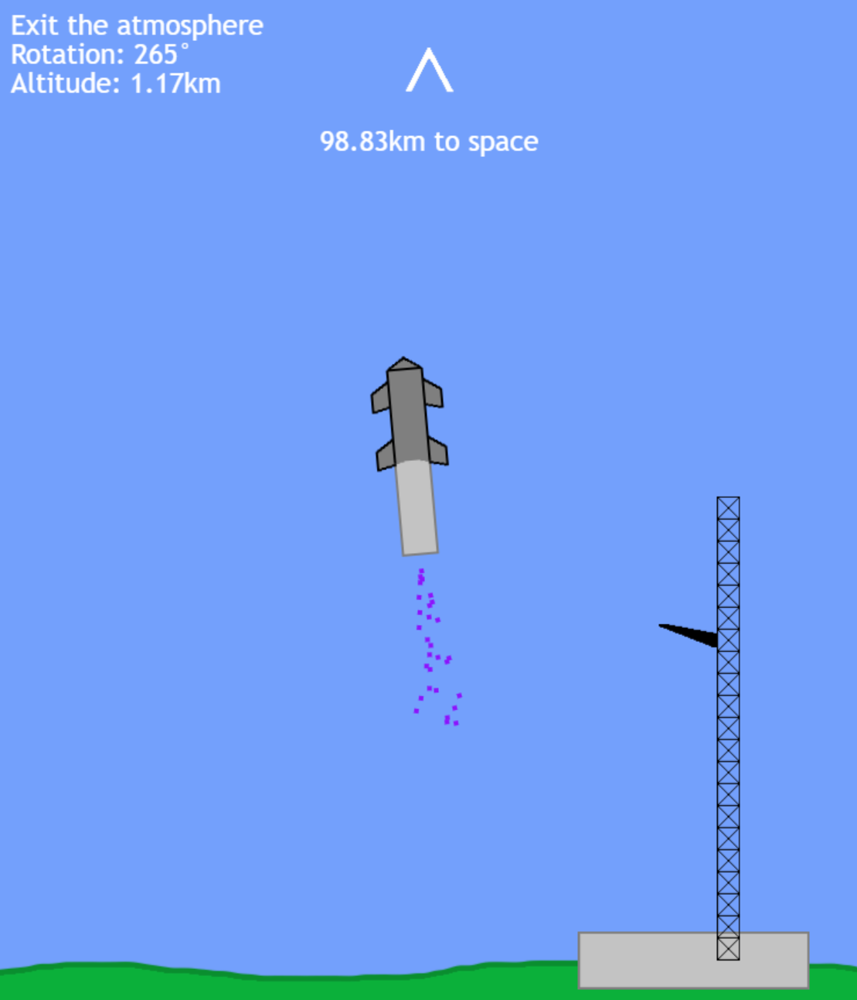

# Starship Lander

A Lunar Lander-style game where you launch a Starship to orbit, deploy Starlink satellites, and bring both the booster and the upper stage back to be caught on the launch tower. Attempt the landing flip maneuver, race the clock, and climb the global leaderboard.

Created by **Jackson Yuen** ([SUBOTIX](https://github.com/CrackerJax3)).

> Unofficial fan game. Not affiliated with, endorsed by, or connected to SpaceX. SpaceX and Starship are trademarks of Space Exploration Technologies Corp.



## Features

- Booster and Starship separation
- Starlink deployment checkpoint and booster-catch checkpoint
- Land both stages to win
- Global leaderboard with best times and flight counts
- Android app (Capacitor) with AdMob ads and a one-time "remove ads" purchase

## Run it

```sh
npm i
npm run dev
```

Android build:

```sh
npm run build
npx cap sync android
cd android && ./gradlew bundleRelease
```

## Setup notes

- **Leaderboard rules:** paste `firestore.rules` into Firebase console, Firestore Database, Rules. It rejects junk names and impossible times. Keep `MIN_TIME_MS` in `leaderboard.js` and the 10000 in the rules in sync.
- **Analytics:** create a Measurement Protocol API secret in GA4 (Admin, Data streams, your stream) and set `API_SECRET` in `analytics.js`. Until then analytics does nothing.
- **Ads:** set `USE_TEST_ADS = true` in `admob.js` while developing.

## Origins

The project began from an open-source Starship lander prototype by Matt-DESTROYER (a Replit bounty project). The game as it stands today is largely original work.

## Todo

- Use state transitions for stages; clean up add/remove EventListeners
- Extract input/control from the ship class
- Add instructions for mobile/touch
- Cosmetic purchases and a web-portal build
- iOS build
